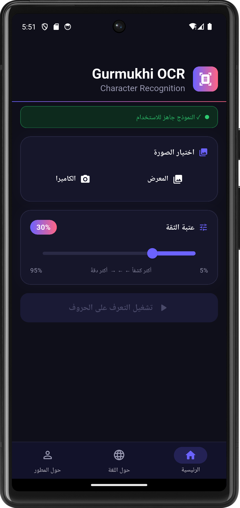
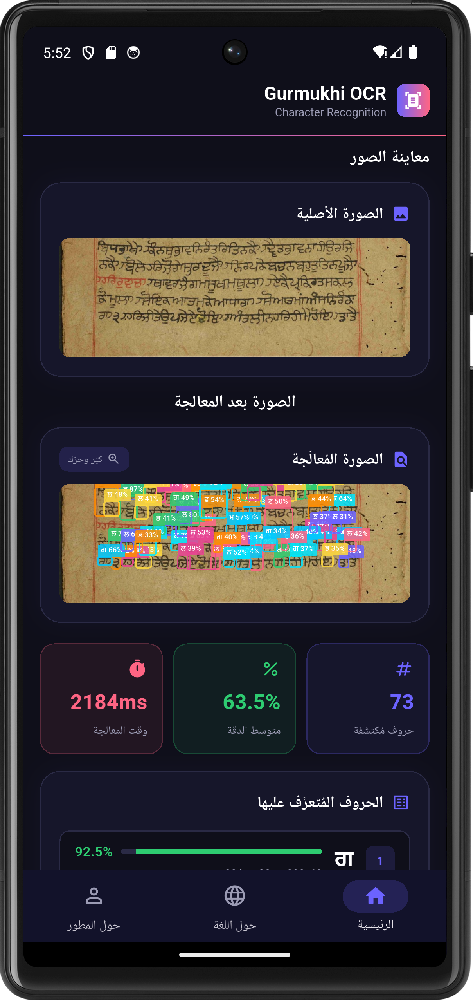
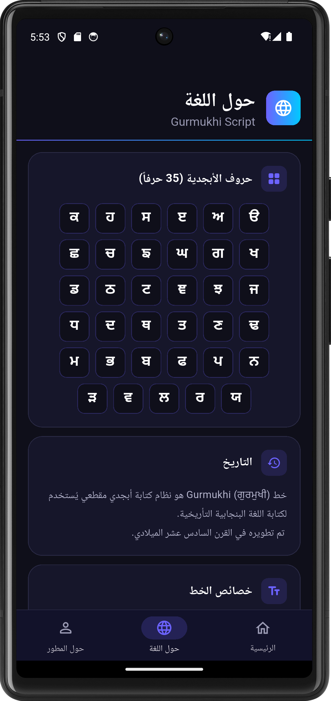

<div align="center">


# Gurmukhi OCR — التعرف على خط Gurmukhi

### تطبيق ذكاء اصطناعي للتعرف على حروف الخط البنجابي باستخدام YOLOv8 + ONNX Runtime

[](https://flutter.dev)
[](https://dart.dev)
[](https://onnxruntime.ai)
[](https://ultralytics.com)
[](LICENSE)
[](pubspec.yaml)

---

**[العربية](#-نظرة-عامة)** | **[English](#-overview)**

</div>

---

<div align="center">

|        الشاشة الرئيسية / Home        |           نتائج التعرف / Results           |             حول اللغة / Language             |
| :----------------------------------: | :----------------------------------------: | :------------------------------------------: |
|  |  |  |
|       اختيار صورة وضبط العتبة        |      الكشف عن الحروف ببطاقات إحصائية       |          أبجدية Gurmukhi (35 حرفاً)          |

</div>

---

#  العربية

## 📖 نظرة عامة

**Gurmukhi OCR** هو تطبيق موبايل مبني بـ Flutter يعتمد على الذكاء الاصطناعي للتعرف التلقائي على حروف خط **Gurmukhi** (ਗੁਰਮੁਖੀ) — نظام الكتابة الأبجدي المقطعي للغة البنجابية.

يعمل التطبيق محلياً بالكامل على الجهاز (On-device AI) دون الحاجة إلى اتصال بالإنترنت، مما يضمن السرعة والخصوصية التامة.

---

## ✨ المميزات الرئيسية

- 🤖 **تعرف آلي دقيق** — نموذج YOLOv8 مُدرَّب خصيصاً على الحروف الـ35 لخط Gurmukhi
- ⚡ **سرعة فائقة** — معالجة فورية باستخدام ONNX Runtime مباشرة على الجهاز
- 📷 **مصادر متعددة للصور** — التقاط من الكاميرا أو رفع من معرض الصور
- 🎯 **عتبة ثقة قابلة للضبط** — تحكم دقيق بين 5% - 95% لتعديل حساسية الكشف
- 🖼️ **مرئيات تفاعلية** — رسم صناديق تحديد ملونة على الحروف المكتشفة مع دعم التكبير/التحريك
- 📊 **إحصائيات مفصّلة** — عدد الحروف، متوسط الدقة، وقت المعالجة، وملخص تكرار الحروف
- 🌙 **واجهة داكنة أنيقة** — تصميم Premium بألوان متدرجة وأنيميشن سلس
- 📚 **محتوى تعليمي** — صفحة تفصيلية عن تاريخ وخصائص خط Gurmukhi

---

## 🛠️ التقنيات المستخدمة

| التقنية                   | الوصف                                     |
| ------------------------- | ----------------------------------------- |
| **Flutter**               | إطار تطوير تطبيقات الموبايل متعدد المنصات |
| **Dart**                  | لغة البرمجة                               |
| **YOLOv8**                | نموذج الذكاء الاصطناعي للكشف عن الكائنات  |
| **ONNX Runtime**          | محرك استدلال الذكاء الاصطناعي (On-device) |
| **image_picker**          | الوصول إلى الكاميرا ومعرض الصور           |
| **path_provider**         | إدارة مسارات الملفات                      |
| **CustomPainter**         | رسم صناديق التحديد على الصور              |
| **Android MethodChannel** | جسر التواصل بين Flutter والكود الأصلي     |

---

## 📋 متطلبات التشغيل

- **Android:** API 21+ (Android 5.0 Lollipop أو أحدث)
- **Flutter SDK:** `^3.11.5`
- **Dart SDK:** `^3.11.5`

---

## 🚀 خطوات التثبيت والتشغيل

### 1. استنساخ المستودع

```bash
git clone https://github.com/YOUR_USERNAME/gurmukhi-ocr.git
cd gurmukhi-ocr
```

### 2. تثبيت المتطلبات

```bash
flutter pub get
```

### 3. إنشاء أيقونة التطبيق

```bash
dart run flutter_launcher_icons
```

### 4. تشغيل التطبيق

```bash
flutter run
```

### 5. بناء نسخة الإنتاج (APK)

```bash
flutter build apk --release
```

---

## 🗂️ هيكل المشروع

```
gurmukhi_ocr/
├── lib/
│   └── main.dart              # الكود الرئيسي للتطبيق (UI + Logic)
├── assets/
│   ├── best.onnx              # نموذج YOLOv8 المُدرَّب (ONNX)
│   ├── gurmukhi_classes.txt   # أسماء الفئات (35 حرفاً)
│   └── icon.jpg               # أيقونة التطبيق
├── android/                   # كود Android الأصلي (ONNX Runtime bridge)
├── model/
│   ├── best.onnx              # نسخة احتياطية من النموذج
│   └── gurmukhi_classes.txt   # ملف التصنيفات
├── screenshots/               # لقطات الشاشة للـ README
├── pubspec.yaml               # إعدادات الحزم والأصول
└── README.md                  # هذا الملف
```

---

## 🧠 كيف يعمل النموذج؟

```
صورة المدخل
    ↓
تحويل إلى Uint8List
    ↓
Android MethodChannel (Flutter → Kotlin)
    ↓
ONNX Runtime inference
    ↓
نموذج YOLOv8 (best.onnx)
    ↓
Post-processing (NMS + Threshold)
    ↓
نتائج: [label, confidence, x1, y1, x2, y2, origW, origH]
    ↓
Flutter UI → عرض Bounding Boxes + إحصائيات
```

---

## 📐 الحروف المدعومة (35 حرفاً)

```
ੳ  ਅ  ੲ  ਸ  ਹ  ਕ  ਖ  ਗ  ਘ  ਙ  ਚ  ਛ  ਜ  ਝ  ਞ
ਟ  ਠ  ਡ  ਢ  ਣ  ਤ  ਥ  ਦ  ਧ  ਨ  ਪ  ਫ  ਬ  ਭ  ਮ
ਯ  ਰ  ਲ  ਵ  ੜ
```

---

## 👨‍💻 المطور

<div align="center">

**واثق المريسي**

مشروع بحثي متقدم في مجال معالجة الصور والرؤية الحاسوبية والذكاء الاصطناعي


## الترخيص

هذا المشروع مرخّص بموجب [رخصة MIT](LICENSE).


</div>

---

#  English

## 📖 Overview

**Gurmukhi OCR** is a Flutter mobile application powered by AI for automatic recognition of **Gurmukhi** (ਗੁਰਮੁਖੀ) characters — the alphasyllabic writing system used for the Punjabi language.

The app runs entirely **on-device** (no internet required), ensuring both speed and complete privacy.

---

## ✨ Key Features

- 🤖 **High-Accuracy AI Recognition** — YOLOv8 model trained specifically on all 35 Gurmukhi characters
- ⚡ **Real-time Performance** — Instant inference using ONNX Runtime directly on the device
- 📷 **Multiple Image Sources** — Capture from camera or pick from photo gallery
- 🎯 **Adjustable Confidence Threshold** — Fine-tune detection sensitivity from 5% to 95%
- 🖼️ **Interactive Visualizations** — Colorful bounding boxes with pinch-to-zoom support on annotated images
- 📊 **Detailed Statistics** — Character count, average confidence, processing time, and frequency summary
- 🌙 **Premium Dark UI** — Elegant glassmorphism design with gradient colors and smooth animations
- 📚 **Educational Content** — Detailed page about the history and characteristics of the Gurmukhi script

---

## 🛠️ Tech Stack

| Technology                | Purpose                          |
| ------------------------- | -------------------------------- |
| **Flutter**               | Cross-platform mobile framework  |
| **Dart**                  | Programming language             |
| **YOLOv8**                | Object detection AI model        |
| **ONNX Runtime**          | On-device AI inference engine    |
| **image_picker**          | Camera and gallery access        |
| **path_provider**         | File path management             |
| **CustomPainter**         | Drawing bounding boxes on images |
| **Android MethodChannel** | Flutter ↔ Native Kotlin bridge   |

---

## 📋 Requirements

- **Android:** API 21+ (Android 5.0 Lollipop or higher)
- **Flutter SDK:** `^3.11.5`
- **Dart SDK:** `^3.11.5`

---

## 🚀 Installation & Setup

### 1. Clone the repository

```bash
git clone https://github.com/YOUR_USERNAME/gurmukhi-ocr.git
cd gurmukhi-ocr
```

### 2. Install dependencies

```bash
flutter pub get
```

### 3. Generate app icon

```bash
dart run flutter_launcher_icons
```

### 4. Run the app

```bash
flutter run
```

### 5. Build release APK

```bash
flutter build apk --release
```

---

## 🗂️ Project Structure

```
gurmukhi_ocr/
├── lib/
│   └── main.dart              # Main app code (UI + Logic)
├── assets/
│   ├── best.onnx              # Trained YOLOv8 model (ONNX format)
│   ├── gurmukhi_classes.txt   # Class labels (35 characters)
│   └── icon.jpg               # App icon
├── android/                   # Native Android code (ONNX Runtime bridge)
├── model/
│   ├── best.onnx              # Model backup copy
│   └── gurmukhi_classes.txt   # Labels file
├── screenshots/               # README screenshots
├── pubspec.yaml               # Package & asset configuration
└── README.md                  # This file
```

---

## 🧠 How the Model Works

```
Input Image
    ↓
Convert to Uint8List bytes
    ↓
Android MethodChannel (Flutter → Kotlin)
    ↓
ONNX Runtime inference
    ↓
YOLOv8 model (best.onnx)
    ↓
Post-processing (NMS + Threshold filtering)
    ↓
Results: [label, confidence, x1, y1, x2, y2, origW, origH]
    ↓
Flutter UI → Bounding Boxes + Statistics Display
```

---

## 📐 Supported Characters (35 Letters)

```
ੳ  ਅ  ੲ  ਸ  ਹ  ਕ  ਖ  ਗ  ਘ  ਙ  ਚ  ਛ  ਜ  ਝ  ਞ
ਟ  ਠ  ਡ  ਢ  ਣ  ਤ  ਥ  ਦ  ਧ  ਨ  ਪ  ਫ  ਬ  ਭ  ਮ
ਯ  ਰ  ਲ  ਵ  ੜ
```

---

## 👨‍💻 Developer

<div align="center">

**Watheq Al-Murisi**

An advanced research project in the field of image processing, computer vision, and artificial intelligence.

</div>

---

## 📄 License

This project is licensed under the MIT License — see the [LICENSE](LICENSE) file for details.

---

<div align="center">

Made with ❤️ using Flutter + YOLOv8 + ONNX Runtime
By Watheq Al-Murisi
</div>
